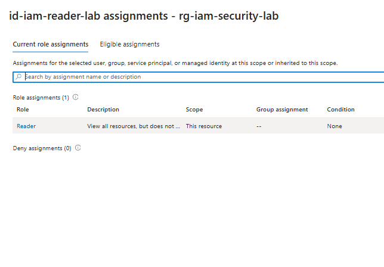
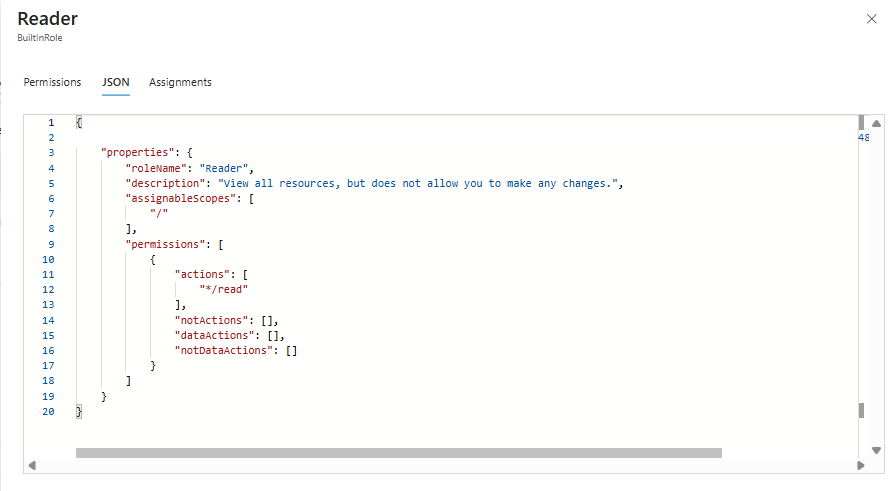
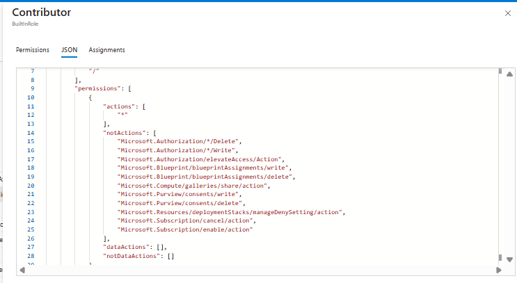

# Azure RBAC Least-Privilege Assessment Lab

This personal Azure lab reviews **role-based access control (RBAC)** using a user-assigned managed identity. I assigned the built-in **Reader** role at resource-group scope, compared it with **Contributor**, and documented the security implications.

> **Scope:** Configuration and role-definition review only. I did not authenticate as the managed identity or perform an API read/write enforcement test.

## Lab environment

| Component | Configuration |
|---|---|
| Subscription | Azure for Students |
| Region | East Asia |
| Resource group | `rg-iam-security-lab` |
| Identity | `id-iam-reader-lab` (user-assigned managed identity) |
| Assigned role | Reader |
| Assignment scope | `rg-iam-security-lab` (This resource) |

The subscription uses an education-managed Microsoft Entra directory. I couldn't access the Entra admin center, so the exercise uses an Azure managed identity rather than attempting to create directory users or change tenant settings.

## Assessment steps

1. Created the IAM lab resource group and a user-assigned managed identity.
2. Assigned **Reader** to the identity at the resource-group scope.
3. Used **Check access** and **Role assignments** to verify the configured role and scope.
4. Reviewed the Reader JSON: `actions: ["*/read"]`, with empty `notActions`, `dataActions`, and `notDataActions`.
5. Reviewed the Contributor JSON: `actions: ["*"]`, with excluded management operations including Azure RBAC role assignment changes.
6. Compared the potential risk of assigning Contributor to an identity that only needs resource visibility.

## IAM-001 — Least-privilege role selection

| Control | Reader | Contributor |
|---|---|---|
| Management-plane actions | `*/read` | `*` with exclusions |
| Read ordinary resource configuration | Yes | Yes |
| Create, change, delete ordinary resources | No | Generally yes |
| Assign Azure RBAC roles by this role alone | No | No |
| Assigned in this lab | **Yes** | **No** |

**Conclusion:** Reader was appropriate for a hypothetical resource-inspection identity. Contributor would grant excessive management permissions for that use case.

**Important nuance:** `notActions` is not an explicit deny; other role assignments can grant an excluded permission. Empty `dataActions` does not guarantee no data exposure via management-plane functionality.

Read the [IAM-001 assessment report](reports/IAM-001.md).

## Evidence

Three screenshots document the role assignment and definitions:

**IAM-001 — Managed identity Reader assignment (resource-group scope)**

**IAM-002 — Reader role definition**

**IAM-003 — Contributor role definition (comparison only; not assigned)**

See [evidence notes](evidence/README.md) and the [RBAC scope diagram](diagrams/rbac-scope.md).

## What was verified

- A managed identity was created for the lab.
- The built-in Reader role was assigned at the intended resource-group scope.
- Azure Portal showed one Reader assignment in **Check access**.
- Reader and Contributor built-in role definitions were compared.

## What was not tested

- Managed identity token acquisition or sign-in through an Azure workload.
- An authenticated Azure management-plane read.
- A denied management-plane write.
- Permission enforcement, effective access outside the reviewed scope, or any penetration testing.

A user-assigned managed identity requires a supported workload to obtain and use its credentials. Portal evidence confirms **configuration**, not runtime enforcement.

## Cleanup

When the lab is no longer needed, remove the Reader assignment and delete the dedicated lab resources after verifying that they contain nothing unrelated.
